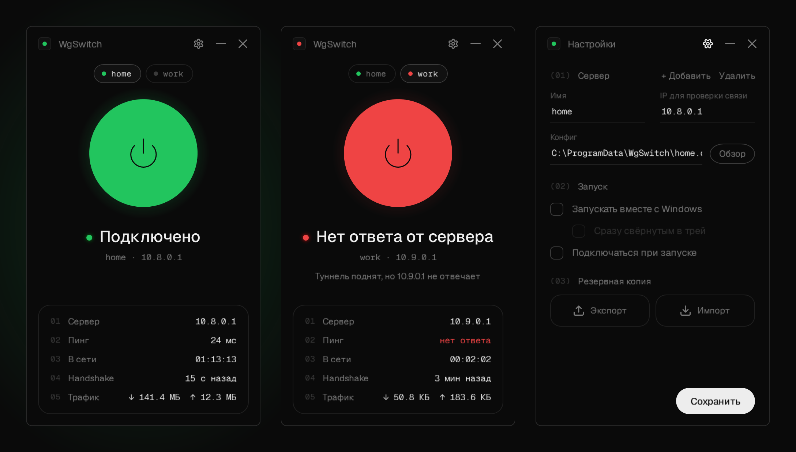
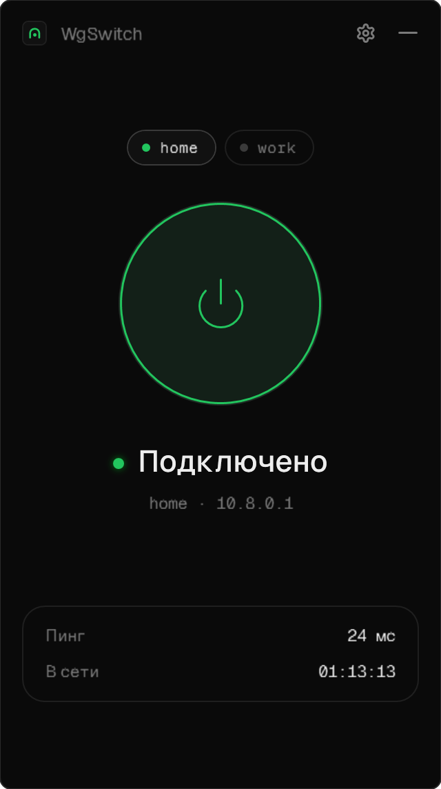
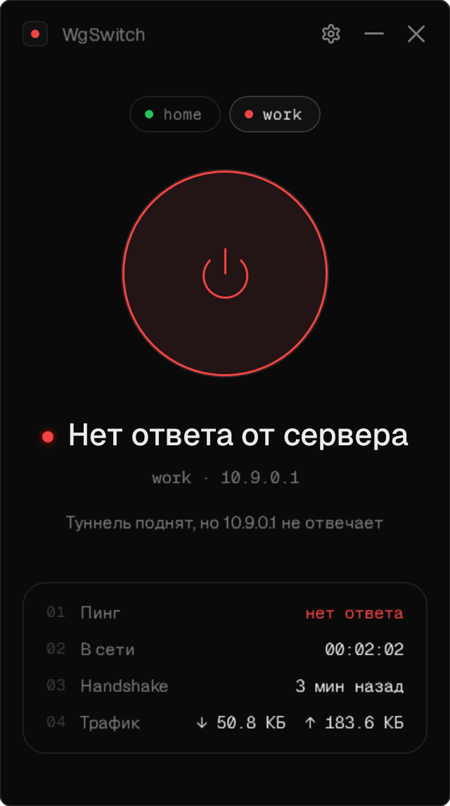
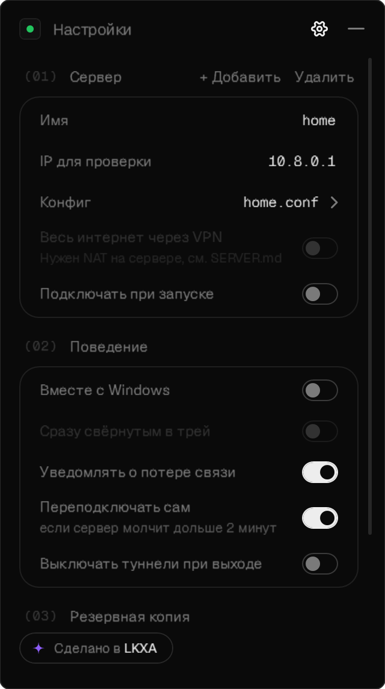
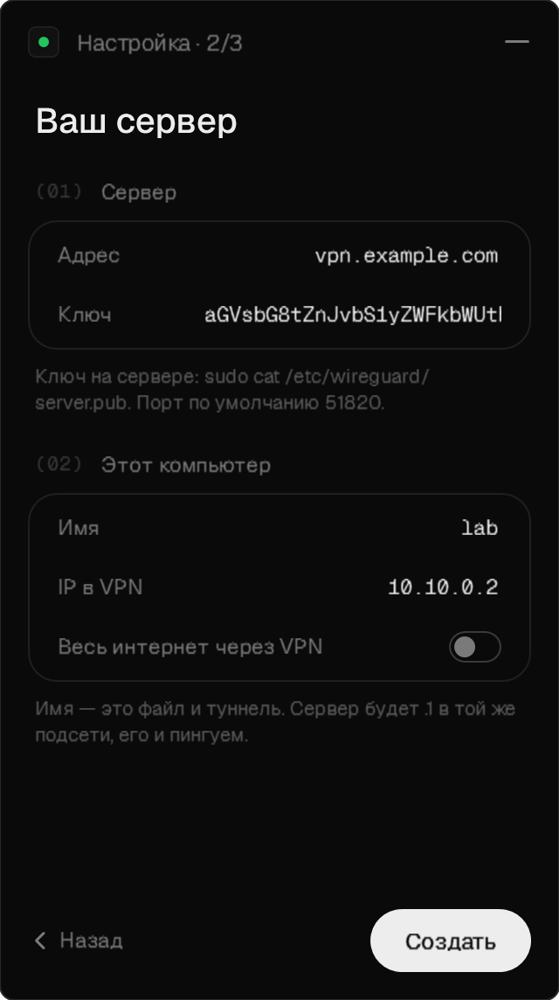
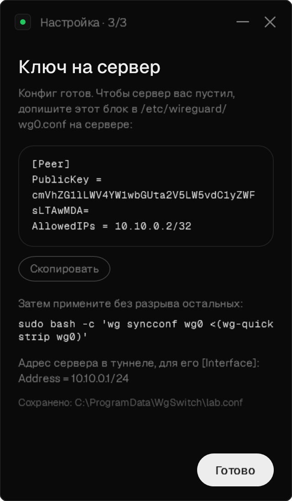
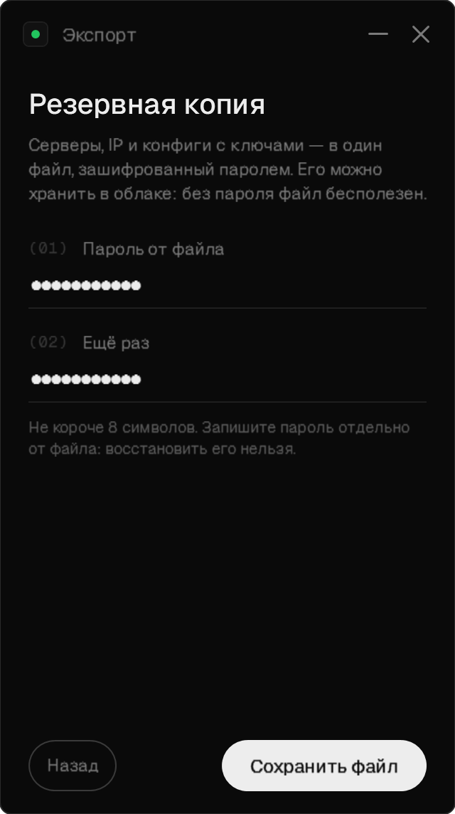
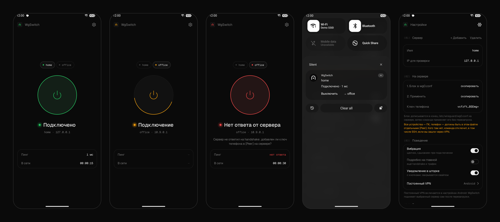

<p align="center">
  
</p>

<h1 align="center">WgSwitch</h1>

<p align="center">
  Лёгкий пульт для личного WireGuard-туннеля под Windows и Android.<br/>
  Одна кнопка, честный индикатор «сервер отвечает» и иконка в трее — без лишнего.
</p>

<p align="center">
  <a href="https://github.com/lolkekxa/WgSwitch/releases/latest"><b>Скачать</b></a> ·
  <a href="#-что-умеет">Что умеет</a> ·
  <a href="#-быстрый-старт">Быстрый старт</a> ·
  <a href="#-несколько-серверов">Серверы</a> ·
  <a href="#-резервная-копия">Резервная копия</a> ·
  <a href="#-android">Android</a> ·
  <a href="#-сервер-одной-командой">Сервер</a> ·
  <a href="docs/SETUP.md">Настройка с нуля</a> ·
  <a href="SERVER.md">Настройка сервера</a> ·
  <a href="TROUBLESHOOTING.md">Ошибки</a> ·
  <a href="#-сборка">Сборка</a>
</p>

<p align="center">
  <a href="https://github.com/lolkekxa/WgSwitch/actions/workflows/build.yml"></a>
  
  
  
  
  <a href="LICENSE"></a>
</p>

<br/>



<br/>

WgSwitch не реализует VPN сам: туннелем занимается официальный клиент WireGuard, а WgSwitch
включает и выключает его службу одной кнопкой и показывает, что на самом деле происходит.
Lite-сборка весит около **0.7 МБ**, сторонних библиотек нет, а в трее программа почти ничего не делает:
когда окно закрыто, память отдаётся системе, а опрос становится редким.

## ✦ Что умеет

<table>
  <tr>
    <td width="33%"></td>
    <td width="33%"></td>
    <td width="33%"></td>
  </tr>
  <tr>
    <td valign="top"><b>Одна кнопка.</b> Цвет состояния — только в тонком кольце и иконке. Ниже пинг и время в сети, по желанию — handshake и трафик; любое значение копируется кликом.</td>
    <td valign="top"><b>Честный статус.</b> WireGuard показывает «Active», даже когда сервер лёг. WgSwitch пингует сервер внутри туннеля и краснеет, если тот молчит.</td>
    <td valign="top"><b>Настройки.</b> Имя, IP для проверки, путь к конфигу, режим «весь интернет через VPN», подробности на главной, автозапуск, запуск свёрнутым в трей, автоподключение и резервная копия.</td>
  </tr>
  <tr>
    <td></td>
    <td></td>
    <td></td>
  </tr>
  <tr>
    <td valign="top"><b>Мастер первого запуска.</b> Адрес и ключ сервера. Пару ключей WgSwitch генерирует сам через <code>wg.exe</code>, а свободную подсеть подбирает под каждый новый сервер.</td>
    <td valign="top"><b>Ключ на сервер.</b> Готовый блок <code>[Peer]</code> для серверного конфига в одно копирование и команда, которая применит его без разрыва соединений.</td>
    <td valign="top"><b>Резервная копия.</b> Все серверы и конфиги в один файл, зашифрованный паролем. Новый компьютер — импорт, и всё снова работает.</td>
  </tr>
</table>

И ещё:

- **Трей.** Серая иконка — выключено, зелёная — подключено, красная — туннель поднят, но сервер не отвечает. Правый клик — включить/выключить каждый сервер, двойной клик — открыть окно.
- **Окно не мешает.** Открывается в правом нижнем углу, как всплывающие окна трея. Кнопка «—» убирает его в трей: программа продолжает работать, а выйти можно из меню иконки.
- **Уведомления.** Если включённый сервер перестал отвечать, приходит уведомление Windows. Когда связь вернётся — ещё одно.
- **Автопереподключение.** После сна или смены Wi-Fi туннель перезапускается, как только сервер промолчит 10 секунд.
  В остальное время — если сервер молчит дольше 2 минут, не чаще раза в 5 минут.
- **Панель сервера.** Кнопка рядом с шестерёнкой: SSH в Windows Terminal, SFTP в FileZilla (если установлен) и веб-панель
  сервера в браузере — всё на адрес внутри туннеля. Точка у каждой строки показывает, открыт ли порт: проверка
  TCP-соединением раз в 5 секунд, только пока панель открыта. Пользователь, порт SSH и адрес панели — у каждого сервера свои.
- **Конфиг для телефона.** Панель сервера → «Телефон»: WgSwitch создаёт телефону свой ключ, показывает QR-код
  для WgSwitch или WireGuard на телефоне и готовый блок `[Peer]` для сервера. Ключ телефона нигде не сохраняется;
  QR и блок сначала размыты, открываются кнопкой «Показать» и прячутся, когда окно теряет фокус.
- **Отмена подключения.** Если подключение затянулось, повторное нажатие на кнопку (или «Выключить» в трее)
  отменяет его. Переключаться между серверами можно в любой момент, даже пока один из них подключается.
- **Автоподключение по серверу.** У каждого сервера свой тумблер «Подключать при запуске».
- **Выход.** По желанию «Выход» из трея выключает все туннели; по умолчанию они остаются работать.
- **Обновления.** При запуске и раз в 12 часов WgSwitch смотрит последний релиз на GitHub. Если вышла новая версия,
  под карточкой на главной появляется «Вышла версия X · Обновить». Установленная копия скачивает установщик,
  сверяет SHA-256 с `SHA256SUMS.txt` из релиза и ставит его поверх, туннели при этом не выключаются; portable и lite
  открывают страницу релиза. Проверку можно выключить в настройках, там же кнопка «Проверить обновления».
- **Экономно.** Опрос раз в 2–3 секунды, только пока окно видно или туннель включён. В простое — раз в 15 секунд и без запуска процессов.
- **Одна копия.** Повторный запуск exe просто показывает уже открытое окно.

## ✦ Быстрый старт

1. Скачайте **`WgSwitch-Setup`** из **[последнего релиза](https://github.com/lolkekxa/WgSwitch/releases/latest)** и установите.
   Если WireGuard ещё не стоит, установщик предложит скачать официальный с wireguard.com. .NET ставить не нужно, он внутри.
2. Запустите WgSwitch. Программа попросит права администратора: без них Windows не даёт ставить и снимать службу туннеля.
3. Пройдите мастер: адрес сервера, его публичный ключ, ваш IP в VPN.
4. Скопируйте блок `[Peer]` с шага 3 в конфиг сервера. Что сделать на сервере целиком, расписано в **[SERVER.md](SERVER.md)**: WireGuard, файрвол и доступ к SSH и панелям только через VPN.
5. Нажмите кнопку. Зелёный — готово.

Что-то не работает — разбор ошибок в **[TROUBLESHOOTING.md](TROUBLESHOOTING.md)**.

Уже есть свой `.conf`? На первом шаге мастера нажмите «У меня есть .conf». Есть резервная копия — «Восстановить из копии».

### Какой файл скачать

| Файл | Для чего |
|---|---|
| `WgSwitch-Setup-x.y.z.exe` | установщик (~45 МБ): ярлык в «Пуске», удаление через «Приложения», по галочке ставит WireGuard |
| `WgSwitch-portable-x.y.z.exe` | один файл без установки, .NET внутри (~63 МБ) |
| `WgSwitch-lite-x.y.z.exe` | один файл на 0.7 МБ, нужен [.NET 8 Desktop Runtime](https://dotnet.microsoft.com/download/dotnet/8.0) |
| `WgSwitch-x.y.z.apk` | Android 8+, движок AmneziaWG встроен — отдельный клиент не нужен |

WireGuard для Windows нужен в любом случае: туннель поднимает именно он. В установщик он не вшит,
а скачивается официальный подписанный — так всегда приходит свежая версия от разработчиков WireGuard.

## ✦ Предупреждение Windows

Exe не подписан сертификатом разработчика, поэтому при первом запуске Windows может предупредить:

- **SmartScreen: «Windows защитил ваш компьютер»** → «Подробнее» → «Выполнить в любом случае».
  Так Windows встречает любой новый неподписанный файл, у которого ещё нет «репутации».
- **Контроль учётных записей: «Неизвестный издатель»** → «Да». Права администратора нужны, чтобы
  ставить и снимать службу туннеля WireGuard.

Убедиться, что файл ровно тот, что собрал GitHub, можно по контрольной сумме из описания релиза:

```powershell
Get-FileHash .\WgSwitch-Setup-1.0.2.exe -Algorithm SHA256
```

Каждый файл в релизах собирается из этого репозитория на GitHub Actions — [журнал сборок](https://github.com/lolkekxa/WgSwitch/actions).
Чтобы предупреждение исчезло, нужна подпись кодом: бесплатно для open source через SignPath Foundation
([как подать заявку](docs/SIGNING.md)) или платный сертификат (например, Certum Open Source). Даже с подписью SmartScreen какое-то время
предупреждает, пока у файла не накопится репутация.

## ✦ Несколько серверов

Настройки → «+ Добавить» открывает тот же мастер. Над кнопкой появляются капсулы серверов с точкой
состояния, а кнопка управляет выбранным.

- **Одновременно.** Держать включёнными можно сразу несколько туннелей, если у серверов разные
  подсети. Мастер сам предлагает свободную: `10.8.0.x`, затем `10.9.0.x` и так далее.
- **Переименовать.** Поле «Имя» в настройках. WgSwitch сам переименует `.conf` и поправит путь (в Windows
  туннель называется по имени файла), так что трогать файл руками не нужно.
- **Весь интернет через VPN.** Галочка в настройках сервера переключает `AllowedIPs` в его `.conf`:
  `0.0.0.0/0, ::/0` или только подсеть сервера. Применяется по «Сохранить», включённый туннель
  сам переподключится. Для полного режима на сервере нужен NAT ([SERVER.md](SERVER.md#-весь-трафик-через-vpn)).
- **Удалить.** Убирает сервер из списка **и удаляет его `.conf`** — вместе с приватным ключом, поэтому
  WgSwitch переспрашивает: первое нажатие меняет надпись на «Точно? Конфиг удалится», второе в течение 3 секунд удаляет.
  Файл не трогается, если на него ссылается другой сервер.

Переименовать и удалить можно только выключенный туннель.

## ✦ Резервная копия

Настройки → «Экспорт» сохраняет в один файл `.wgsb` все серверы, их IP и сами конфиги **вместе
с приватными ключами**. Без ключей после потери компьютера в туннель не войти, поэтому файл
зашифрован паролем, и его можно спокойно хранить в облаке:

| | |
|---|---|
| Шифр | AES-256-GCM: неверный пароль и подмену файла видно сразу |
| Ключ из пароля | PBKDF2-SHA256, 600 000 итераций, случайная соль |
| Пароль | не короче 8 символов; восстановить его нельзя |

Восстановить: «Импорт» в настройках или «Восстановить» на первом шаге мастера. Конфиги ложатся
в `C:\ProgramData\WgSwitch`, серверы с теми же именами заменяются, остальные остаются. Отличающийся
конфиг на диске не затирается, а переименовывается в `.bak`.

## ✦ Android



Тот же WgSwitch на телефоне: та же кнопка с кольцом, те же цвета и анимации, честный статус по пингу
и handshake. Отдельный клиент WireGuard не нужен — движок встроен.

- **Движок AmneziaWG.** WireGuard с маскировкой пакетов: работает там, где провайдер режет обычный WireGuard
  (признак — связь на несколько секунд, потом «Нет ответа», и так по кругу). Обычные конфиги WireGuard тоже работают.
- **Добавить сервер.** QR-код (из `wgswitch-server` или «Телефон» в WgSwitch на ПК), файл `.conf`
  или резервная копия `.wgsb` с ПК — формат общий, переносится в обе стороны.
- **На сервере.** В настройках — публичный ключ телефона и готовый блок `[Peer]` с командой применения, всё копируется касанием.
- **Вибрация.** Щелчок при нажатии, тики пока идёт подключение, двойной толчок — подключилось, глухой удар — сервер молчит.
- **Шторка и рабочий стол.** Уведомление с кнопками «Включить/Выключить» и «→ следующий сервер» (закрывается
  свайпом), плитка быстрых настроек, виджет и «Постоянный VPN» Android.
- **Сам переподключается.** Сервер молчит дольше 20 секунд — туннель перезапускается со свежим handshake, не чаще раза в минуту.

APK — в [релизах](https://github.com/lolkekxa/WgSwitch/releases/latest), файл `WgSwitch-x.y.z.apk`; подробная установка — в [docs/SETUP.md](docs/SETUP.md#-3-телефон-android).

## ✦ Сервер одной командой

```bash
curl -fsSL https://raw.githubusercontent.com/lolkekxa/WgSwitch/main/server/wgswitch-server.sh \
  -o /usr/local/bin/wgswitch-server && chmod +x /usr/local/bin/wgswitch-server && wgswitch-server
```

[`wgswitch-server`](server/wgswitch-server.sh) поднимает туннель WireGuard или AmneziaWG и добавляет устройства,
спрашивая по-русски (Enter — ответ по умолчанию): новое устройство — это имя, а в ответ QR для телефона и `.conf`
для ПК. Ещё — добавить по ключу из мастера WgSwitch, список с последним handshake, удалить. Устройства
добавляются без переподключения остальных, ключ сервера хранится в `PrivateKey`. Подробно — в
[SERVER.md](SERVER.md#-быстро-одна-команда) и [docs/SETUP.md](docs/SETUP.md).

## ✦ Безопасность

- **Конфиги.** Мастер кладёт их в `C:\ProgramData\WgSwitch`, а доступ к папке есть только у Администраторов и SYSTEM.
- **Приватный ключ.** Существует только в `.conf`. Приложение видит его, когда создаёт ключ (`wg genkey`), шифрует резервную копию и переписывает `AllowedIPs` при смене режима. Ключ держится только в памяти, в логи и настройки не попадает, а при смене режима остаётся в том же файле.
- **Настройки.** В `%APPDATA%\WgSwitch\settings.json` лежат только пути, IP и флаги.
- **Handshake и трафик.** Читаются через `wg show <имя> latest-handshakes` и `transfer`, а не через `dump`: `dump` выводит приватный ключ.
- **Автозапуск.** Это задача планировщика «при входе» с наивысшими правами. Ключ реестра `Run` не подходит: программы с `requireAdministrator` Windows через него молча не запускает.

<details>
<summary><b>Свой <code>.conf</code> вручную</b></summary>

<br/>

Укажите путь в настройках. В конфиге лежит приватный ключ, поэтому закройте папку от обычных
пользователей (PowerShell от администратора):

```powershell
New-Item -ItemType Directory -Force C:\ProgramData\WgSwitch | Out-Null
Copy-Item .\wg0.conf C:\ProgramData\WgSwitch\
icacls C:\ProgramData\WgSwitch /inheritance:r /grant:r "*S-1-5-32-544:(OI)(CI)F" "*S-1-5-18:(OI)(CI)F"
```

Имя файла становится именем туннеля: `wg0.conf` → `wg0` → служба `WireGuardTunnel$wg0`.
Допустимы латиница, цифры и `_=+.-`, до 32 символов.

</details>

## ✦ Сборка

Каждый пуш на GitHub Actions прогоняет тесты (Windows и Android) и собирает установщик, portable, lite и APK.
APK подписывается постоянным ключом из секретов репозитория `ANDROID_KEYSTORE_BASE64`, `ANDROID_KEYSTORE_PASSWORD`,
`ANDROID_KEY_ALIAS`, `ANDROID_KEY_PASSWORD`; без них APK в сборках `main` пропускается, а релиз по тегу не выйдет.

- пуш в `main` обновляет пре-релиз [`dev`](https://github.com/lolkekxa/WgSwitch/releases/tag/dev) — свежая сборка для проверки;
- тег вида `v1.2.0` выпускает постоянный релиз «WgSwitch 1.2.0» с описанием из [CHANGELOG.md](CHANGELOG.md).

Версия берётся из тега (`v1.2.0` → `1.2.0`), сборки из `main` получают `1.2.0-dev.N`. Её видно внизу настроек.

Локально нужен .NET SDK 8 или новее:

```powershell
# тесты
dotnet test tests/WgSwitch.Tests/WgSwitch.Tests.csproj

# один файл (~0.7 МБ), нужен .NET 8 Desktop Runtime
dotnet publish -c Release -r win-x64 --self-contained false -p:PublishSingleFile=true -o publish

# один файл без зависимостей (~65 МБ), runtime внутри
dotnet publish -c Release -r win-x64 --self-contained true -p:PublishSingleFile=true -p:EnableCompressionInSingleFile=true -o publish-sc
```

Урезать self-contained сборку через `PublishTrimmed` нельзя: .NET запрещает trimming для WPF и WinForms
(ошибки NETSDK1168 и NETSDK1175).

**Android** (папка `android/`): JDK 17+ (подойдёт встроенный в Android Studio) и Android SDK.

```powershell
cd android
.\gradlew :app:testDebugUnitTest      # тесты: резервная копия (в т. ч. файл от Windows-версии), разбор конфига
.\gradlew :app:assembleRelease        # app/build/outputs/apk/release/app-release.apk
```

Движок AmneziaWG лежит готовым в `android/app/libs/` (собран из
[amneziawg-android](https://github.com/amnezia-vpn/amneziawg-android) v3.1.20260814, Apache-2.0).
Пересобрать его — [`android/tools/build-awg.sh`](android/tools/build-awg.sh) под Linux или WSL: скрипт сам
скачает JDK, Android SDK, NDK и Go.

**Скрипт сервера** проверяется без root и без WireGuard — на поддельных `wg`/`awg`: `bash server/test/run.sh` (Linux/WSL).

<details>
<summary><b>Как это устроено</b></summary>

<br/>

| Действие | Как |
|---|---|
| Включить | `wireguard.exe /installtunnelservice "<путь к .conf>"` |
| Выключить | `wireguard.exe /uninstalltunnelservice <имя>` |
| Состояние | служба `WireGuardTunnel$<имя>` через SCM, затем пинг до IP сервера внутри туннеля |
| Handshake и трафик | `wg.exe show <имя> latest-handshakes` / `transfer` |
| Новые ключи | `wg.exe genkey` / `pubkey` |

```
App.xaml(.cs)               запуск, одна копия (Mutex), трей, показ и уничтожение окна
MainWindow.xaml(.cs)        окно: кнопка, статус, серверы, настройки, мастер, резервная копия
Models/TunnelStatus.cs      состояние туннеля
Services/WireGuardService   install/uninstall, опрос служб, пинг, wg show — для всех серверов
Services/TrayService        NotifyIcon: иконки рисуются в рантайме, тёмное меню
Services/SettingsService    settings.json, список серверов, автозапуск
Services/ConfigFactory      мастер: проверка ввода, ключи, конфиг в закрытой папке
Services/BackupService      зашифрованная резервная копия (.wgsb)
Services/UpdateService      проверка релизов на GitHub, скачивание и проверка SHA-256 установщика
Services/NetProbe           проверка TCP-портов сервера для панели сервера
Services/QrCode             QR-код без сторонних библиотек (для «Телефон → QR-код»)
Services/Native             DWM, SCM, сброс рабочего набора
Services/Proc               запуск внешних утилит без окна консоли
Assets/                     шрифты Geist (OFL), иконка приложения
installer/WgSwitch.iss      установщик (Inno Setup 6)
tests/WgSwitch.Tests        тесты: мастер, «весь интернет», резервная копия, настройки, обновления,
                            проверка портов, QR (сверка с декодером ZXing), конфиг телефона
android/                    приложение для Android: Kotlin, Jetpack Compose, движок AmneziaWG
server/wgswitch-server.sh   настройка сервера и устройств; server/test — его проверка
```

Сторонних NuGet-пакетов в программе нет: WPF для окна, `System.Windows.Forms.NotifyIcon` для трея, остальное —
стандартная библиотека и несколько вызовов Win32. В тестах — xUnit и ZXing.Net (проверить QR-кодировщик независимым декодером).

</details>

## ✦ Автор

Сделано в **[LKXA](https://lkxa.ru)**: Telegram-боты, Mini Apps и веб-сервисы под ключ.
Дизайн повторяет сайт студии: тёмная тема, шрифт Geist, капсулы и мягкие анимации.

- Портфолио — **[lkxa.ru](https://lkxa.ru)**
- Telegram — **[@lkxa_dev](https://t.me/lkxa_dev)**
- Канал — **[@lkxa_ru](https://t.me/lkxa_ru)**
- Почта — **[lkxa.dev@gmail.com](mailto:lkxa.dev@gmail.com)**

## ✦ Лицензия

[MIT](LICENSE). Шрифты Geist и Geist Mono — [SIL Open Font License 1.1](Assets/Fonts/OFL.txt).

<br/>

<p align="center">
  <a href="https://lkxa.ru/?ref=badge"></a>
</p>
