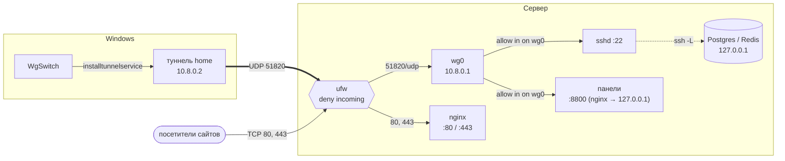
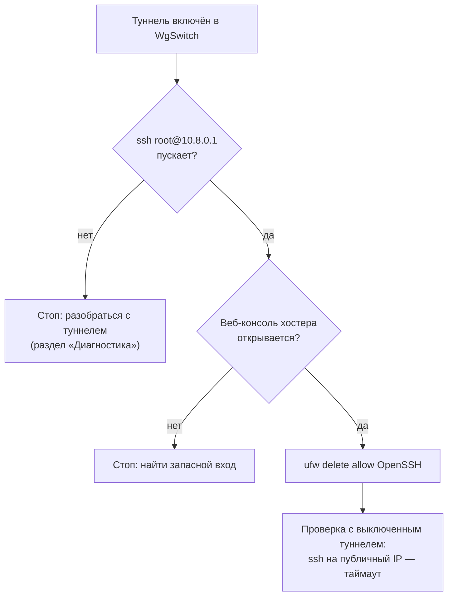

<h1 align="center">✦ Сервер: админка только через VPN</h1>

<p align="center">
  Настройка Linux-сервера под WgSwitch: WireGuard, файрвол и доступ к SSH, панелям и базам<br/>
  только изнутри туннеля. Сайты и прочие публичные сервисы продолжают работать как раньше.
</p>

<p align="center">
  <a href="#-схема">Схема</a> ·
  <a href="#-0-аудит">Аудит</a> ·
  <a href="#-1-wireguard">WireGuard</a> ·
  <a href="#-3-файрвол">Файрвол</a> ·
  <a href="#-5-закрыть-публичный-ssh">SSH</a> ·
  <a href="#-6-панели-docker-базы">Панели и Docker</a> ·
  <a href="#-несколько-серверов">Несколько серверов</a> ·
  <a href="#-диагностика">Диагностика</a>
</p>

<p align="center">
  
  
  
  
</p>

<br/>

## ✦ Схема



| Трафик | Откуда | Правило | Доступ |
|---|---|---|---|
| WireGuard | интернет | `51820/udp` | публично; без ключа сервер на пакеты не отвечает |
| Сайты | интернет | `80,443/tcp` | публично |
| Другой VPN (Xray, OpenVPN…) | интернет | его порт | публично |
| SSH, SFTP | только `wg0` | `allow in on wg0` | с включённым туннелем |
| Панели | только `wg0` | отдельный порт nginx, снаружи не открыт | с включённым туннелем |
| Базы | `127.0.0.1` | не публикуются | через `ssh -L` |

Туннель раздельный (split tunnel): клиент ведёт через `wg0` только подсеть `10.8.0.0/24`, остальной
трафик идёт как обычно. Поэтому WgSwitch не конфликтует с другим VPN на компьютере.

> [!WARNING]
> До проверки SSH через туннель (шаг 5) не удаляйте публичное правило для SSH. Заранее убедитесь,
> что открывается веб-консоль хостера (VNC/KVM): только через неё можно вернуть доступ, если
> файрвол настроен неправильно.

## ✦ 0. Аудит

Сначала посмотрите, что уже есть на сервере:

```bash
ss -tulpn                                              # кто что слушает
ip -br a; wg show 2>/dev/null                          # интерфейсы, существующий WireGuard
docker ps --format '{{.Names}}\t{{.Ports}}' 2>/dev/null # опубликованные порты контейнеров
ufw status verbose 2>/dev/null; nft list ruleset 2>/dev/null | head -50
grep -RHn "server_name\|proxy_pass\|listen" /etc/nginx/sites-enabled/ 2>/dev/null
```

На что смотреть:

| Что | Значит |
|---|---|
| `0.0.0.0:<порт>` у панели, node, БД | сервис открыт всем, если не закрыт файрволом |
| `docker-proxy` на `0.0.0.0:<порт>` | **открыт всем в любом случае**: Docker обходит ufw (шаг 6) |
| `ufw: Status: inactive` и пустой `nft` | файрвола нет, открыто всё, что слушает `0.0.0.0` |
| `proxy_pass http://127.0.0.1:<порт>` | этот порт нужен только nginx, снаружи его можно закрыть |
| уже есть `wg0`, `51820/udp` или `10.8.0.0/24` | конфликт с этим гайдом, см. ниже |

**Если на сервере уже есть WireGuard** (wg-easy по умолчанию занимает `wg0`, `51820/udp` и
`10.8.0.0/24`), есть два варианта:

- **Стать клиентом существующего VPN.** Создайте в нём ещё одного клиента, импортируйте его `.conf` в
  WgSwitch («У меня есть .conf»), в поле «IP для проверки связи» укажите адрес сервера внутри VPN.
  Шаги 1–2 пропускаются.
- **Отдельный туннель.** Везде ниже замените `wg0` → `wg1`, `51820` → `51830`, `10.8.0.` → `10.9.0.`.

## ✦ 1. WireGuard

```bash
apt update && apt install -y wireguard
cd /etc/wireguard && umask 077
wg genkey | tee server.key | wg pubkey > server.pub
cat server.pub      # → WgSwitch, мастер, поле «Публичный ключ сервера»
```

## ✦ 2. Пир клиента

Пройдите мастер WgSwitch до шага 3: он сгенерирует ключи клиента и покажет блок `[Peer]` и `Address`
сервера. Подставьте ключ клиента и выполните:

```bash
cat > /etc/wireguard/wg0.conf <<'EOF'
[Interface]
Address = 10.8.0.1/24
ListenPort = 51820
# приватный ключ берётся из файла и не лежит в конфиге
PostUp = wg set %i private-key /etc/wireguard/server.key

[Peer]
PublicKey = <ключ клиента из WgSwitch>
AllowedIPs = 10.8.0.2/32
EOF
chmod 600 /etc/wireguard/wg0.conf
systemctl enable --now wg-quick@wg0
wg show
```

`enable` одновременно ставит туннель в автозапуск. Кавычки в `<<'EOF'` нужны, чтобы shell не подставил `%i`.

## ✦ 3. Файрвол

Если на сервере уже есть свои правила `iptables`/`nftables` или файрвол панели, **не ставьте ufw
поверх**: перенесите в существующую систему ту же матрицу из раздела «Схема».

Порядок важен: SSH разрешается **до** `ufw enable`, иначе текущая сессия оборвётся.

```bash
apt install -y ufw
ufw default deny incoming
ufw default allow outgoing

ufw allow OpenSSH            # временно, удалим на шаге 5
ufw allow 51820/udp          # WireGuard
ufw allow in on wg0          # всё из туннеля
ufw allow 80,443/tcp         # сайты
# ufw allow 443/udp          # HTTP/3, если включён в nginx
# ufw allow <порт>/tcp       # другой публичный сервис: Xray, OpenVPN и т. п.

ufw enable
ufw status verbose
```

Варианты и подводные камни:

- **Выборочный доступ из туннеля.** Вместо `ufw allow in on wg0` можно перечислить порты:
  `ufw allow in on wg0 to any port 22 proto tcp` и так далее.
- **Другой VPN на сервере не в Docker** (wg-quick, OpenVPN, AmneziaWG). У ufw по умолчанию
  `deny (routed)`, и клиенты такого VPN останутся без интернета. Разрешите пересылку:
  ```bash
  ip route | grep default                         # внешний интерфейс, например eth0
  ufw route allow in on <интерфейс VPN> out on eth0
  ```
- **Облачный файрвол хостера** (security group). `51820/udp` нужно открыть и там.

Сразу после `ufw enable` проверьте сайты и другой VPN.

## ✦ 4. Проверка туннеля

Включите сервер в WgSwitch. Ожидаемо: «Подключено», пинг в миллисекундах, свежий handshake.

```bash
wg show wg0          # latest handshake: несколько секунд назад, transfer растёт
```

## ✦ 5. Закрыть публичный SSH



```bash
ufw delete allow OpenSSH     # удаляет правило и для IPv4, и для IPv6
ufw status
```

Текущая сессия не оборвётся: ufw пропускает уже установленные соединения. Проверяйте новым подключением.

> [!IMPORTANT]
> Всё, что ходит на сервер по SSH снаружи (деплой из GitHub Actions, скрипты с других машин),
> после этого шага перестанет работать: у них нет туннеля. Перенесите деплой на pull-модель
> или разрешите SSH с конкретного адреса: `ufw allow from <IP> to any port 22 proto tcp`.

**Откат** (через веб-консоль хостера): `ufw allow OpenSSH`.

## ✦ 6. Панели, Docker, базы

### Панели через nginx

**Не используйте `listen 10.8.0.1:…`.** Адрес существует только пока поднят `wg0`. Если nginx
стартует раньше туннеля или туннель перезапустят, `nginx -t` упадёт, и вместе с панелью
перестанут работать **все сайты** на этом nginx.

Рабочая схема: отдельный порт на всех интерфейсах, снаружи его закрывает ufw, внутри nginx ещё
раз проверяет адрес клиента.

```nginx
# /etc/nginx/sites-available/vpn-admin
server {
    listen 8800;
    allow 10.8.0.0/24;
    deny all;

    location / {
        proxy_pass http://127.0.0.1:8081;     # сервис панели
        proxy_set_header Host $host;
        proxy_set_header X-Forwarded-For $proxy_add_x_forwarded_for;
        proxy_http_version 1.1;
        proxy_set_header Upgrade $http_upgrade;
        proxy_set_header Connection "upgrade";
    }
}
```

```bash
ln -s /etc/nginx/sites-available/vpn-admin /etc/nginx/sites-enabled/
nginx -t && systemctl reload nginx
```

Открывать по `http://10.8.0.1:8800`. HTTPS не нужен: трафик уже шифрует WireGuard. Если сервис сам
слушает `0.0.0.0:<порт>`, nginx не обязателен: ufw закрывает этот порт снаружи, а через туннель он
доступен по `http://10.8.0.1:<порт>`.

**Админка на публичном домене** (`https://site/admin`, поддомен с Adminer): `allow 10.8.0.0/24`
в таком `location` не сработает. При раздельном туннеле запрос на публичный IP идёт мимо `wg0`, с
обычного адреса клиента. Уберите публичный вход и откройте админку на отдельном порту, как выше.

### Docker

Docker пишет свои правила в `iptables` до ufw, поэтому `-p 5432:5432` открыт всему интернету
независимо от `ufw status`. Публикуйте служебные порты только на loopback:

```yaml
# docker-compose.yml
ports:
  - "127.0.0.1:5432:5432"
```

```bash
docker inspect <контейнер> --format '{{ index .Config.Labels "com.docker.compose.project.working_dir" }}'
docker compose up -d
ss -tlnp | grep 5432          # должно быть 127.0.0.1:5432
```

Перед этим проверьте, не подключается ли к сервису кто-то снаружи:

```bash
ss -tn state established '( sport = :5432 )'   # внешние адреса в Peer — не закрывать вслепую
```

Контейнеры с `network_mode: host` проброса портов не имеют, их закрывает обычный ufw.

### Базы

Остаются на `127.0.0.1`. Доступ с компьютера при включённом туннеле:

```powershell
ssh -L 5432:127.0.0.1:5432 root@10.8.0.1     # затем клиент БД → localhost:5432
```

В DBeaver, DataGrip или pgAdmin то же самое настраивается на вкладке SSH: хост `10.8.0.1`, сама база —
`127.0.0.1:5432`.

## ✦ 7. Клиент

**Вход по ключу**, без пароля (PowerShell, туннель включён):

```powershell
ssh-keygen -t ed25519                                    # если ключа ещё нет; passphrase можно пустой
type $env:USERPROFILE\.ssh\id_ed25519.pub | ssh root@10.8.0.1 "mkdir -p ~/.ssh && chmod 700 ~/.ssh && cat >> ~/.ssh/authorized_keys && chmod 600 ~/.ssh/authorized_keys"
```

**Короткие имена** в `%USERPROFILE%\.ssh\config` (их подхватывает и VS Code Remote-SSH):

```
Host home
    HostName 10.8.0.1
    User root

Host work
    HostName 10.9.0.1
    User root
```

**FileZilla**: протокол SFTP, хост `10.8.0.1`, порт 22. Для входа по ключу: «Тип входа» → «Файл с
ключом» → `id_ed25519` (FileZilla предложит сконвертировать его в `.ppk`). Предупреждение о новом
ключе хоста при первом подключении нормально: для клиента это новый адрес.

## ✦ Несколько серверов

У каждого сервера своя подсеть, тогда туннели можно держать включёнными одновременно. Мастер
WgSwitch предлагает следующую свободную сам.

| Сервер | `Address` на сервере | `AllowedIPs` пира | Клиент | SSH |
|---|---|---|---|---|
| первый | `10.8.0.1/24` | `10.8.0.2/32` | `10.8.0.2` | `10.8.0.1` |
| второй | `10.9.0.1/24` | `10.9.0.2/32` | `10.9.0.2` | `10.9.0.1` |
| третий | `10.10.0.1/24` | `10.10.0.2/32` | `10.10.0.2` | `10.10.0.1` |

На втором сервере всё как выше, с заменой `10.8.0.` → `10.9.0.` в `wg0.conf`, файрволе и nginx.
Интерфейс на сервере может везде называться `wg0`: имя туннеля в WgSwitch (`home`, `work`) живёт
только на Windows.

## ✦ Ещё одно устройство

Каждому клиенту нужен свой ключ и свой адрес. Пройдите мастер WgSwitch на втором компьютере с IP
`10.8.0.3`, допишите его `[Peer]` в серверный `wg0.conf` и примените без разрыва текущих соединений:

```bash
bash -c 'wg syncconf wg0 <(wg-quick strip wg0)'
```

## ✦ Весь трафик через VPN

Нужно только если в мастере включена галочка «Весь интернет через VPN». Если на компьютере уже
есть VPN на весь трафик, её лучше не включать: два туннеля с `0.0.0.0/0` конфликтуют.

```bash
echo 'net.ipv4.ip_forward=1' > /etc/sysctl.d/99-wireguard.conf && sysctl --system
ip route | grep default        # внешний интерфейс, например eth0 или ens3
```

В `[Interface]` серверного `wg0.conf` (вместо `eth0` ваш интерфейс):

```ini
PostUp   = iptables -t nat -A POSTROUTING -s 10.8.0.0/24 -o eth0 -j MASQUERADE
PostDown = iptables -t nat -D POSTROUTING -s 10.8.0.0/24 -o eth0 -j MASQUERADE
```

```bash
ufw route allow in on wg0 out on eth0
systemctl restart wg-quick@wg0
```

## ✦ Проверка снаружи

С машины **без** туннеля:

```bash
nmap -Pn <публичный IP>                 # открыты только 80/443 и явно разрешённые порты
nmap -Pn -sU -p 51820 <публичный IP>    # open|filtered — норма: WireGuard молчит на чужие пакеты
```

## ✦ Диагностика

Сообщения WgSwitch и подробный разбор «Нет ответа от сервера» — в [TROUBLESHOOTING.md](TROUBLESHOOTING.md).

| Симптом | Причина и что проверить |
|---|---|
| «Нет ответа от сервера», handshake пустой | `51820/udp` закрыт в ufw или в облачном файрволе хостера; неверный адрес или ключ сервера в мастере |
| Handshake есть, пинга нет | `AllowedIPs` пира на сервере не равен IP клиента (`10.8.0.2/32`); нет `ufw allow in on wg0` |
| SSH на публичный IP работает при выключенном туннеле | не удалено правило `OpenSSH` (`ufw status numbered`) или туннель на самом деле поднят (`Get-Service 'WireGuardTunnel$*'`) |
| После `ufw enable` клиенты другого VPN без интернета | `deny (routed)`: нужен `ufw route allow in on <интерфейс VPN> out on <внешний>` |
| Сервис доступен снаружи, хотя порта нет в ufw | опубликован Docker на `0.0.0.0` → `127.0.0.1:порт:порт` |
| Сайты отдают 502 | упало приложение за `proxy_pass` (`ss -tlnp` — порта нет), файрвол тут ни при чём |
| nginx не стартует после перезагрузки | `listen 10.8.0.1:…` — адрес появляется позже nginx; перейдите на отдельный порт (шаг 6) |
| Потерян доступ по SSH | веб-консоль хостера → `ufw allow OpenSSH` |

<br/>

<p align="center">
  <a href="README.md">← WgSwitch</a> ·
  <a href="https://lkxa.ru/?ref=badge"></a>
</p>
