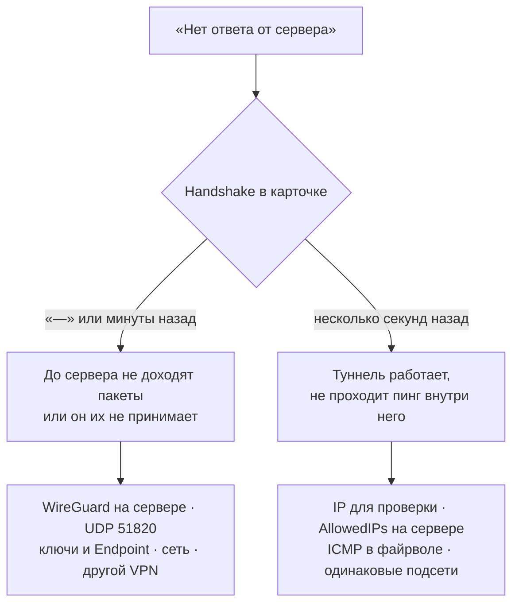

<h1 align="center">✦ Ошибки и как их лечить</h1>

<p align="center">
  Что значат сообщения WgSwitch и что проверить, если туннель поднят, а сервер не отвечает.
</p>

<p align="center">
  <a href="#-нет-ответа-от-сервера">Нет ответа от сервера</a> ·
  <a href="#-команды-для-проверки">Команды</a> ·
  <a href="#-сообщения-программы">Сообщения программы</a> ·
  <a href="SERVER.md">Настройка сервера</a>
</p>

<br/>

## ✦ «Нет ответа от сервера»

Полный текст: «Туннель поднят, но 10.8.0.1 не отвечает». Служба WireGuard на компьютере работает,
но пинг до «IP для проверки» из настроек не проходит два раза подряд. Если сервер молчит дольше
2 минут, WgSwitch сам перезапускает туннель (тумблер «Переподключать сам»). После сна или смены сети ждать
не нужно: туннель перезапускается, если сервер молчит дольше 10 секунд.

Первым делом посмотрите на строку **Handshake** в карточке на главном экране. По ней видно,
где искать причину:



### Handshake «—» или давно: сервер не отвечает на рукопожатие

| Причина | Как проверить | Что сделать |
|---|---|---|
| WireGuard на сервере не запущен | `systemctl status wg-quick@wg0`, `wg show` пустой | `systemctl enable --now wg-quick@wg0` |
| UDP 51820 закрыт файрволом сервера | `ufw status \| grep 51820` | `ufw allow 51820/udp` |
| UDP 51820 закрыт у хостера (облачный файрвол, security group) | на сервере `tcpdump -ni any udp port 51820`, нажать «Включить» — пакетов нет | открыть 51820/udp в панели хостера |
| Ключ клиента не добавлен на сервер или правка не применена | `wg show wg0 peers` — нет ключа клиента | дописать `[Peer]` из мастера, `bash -c 'wg syncconf wg0 <(wg-quick strip wg0)'` |
| В конфиге клиента чужой ключ сервера | сравнить `cat /etc/wireguard/server.pub` с `PublicKey` в `[Peer]` клиента | пересоздать сервер в мастере с верным ключом |
| Неверный адрес сервера (`Endpoint`) | IP, домен и порт в конфиге клиента | исправить или пересоздать сервер в мастере |
| Сеть режет UDP (общественный Wi-Fi, офис, часть мобильных операторов) | раздать интернет с телефона — заработало | сменить порт на сервере, например на `443/udp` (если на нём не HTTP/3), и `Endpoint` у клиента |
| Провайдер распознаёт и режет WireGuard (DPI) | handshake проходит, связь живёт 5–20 секунд и пропадает; на сервере `tcpdump -ni eth0 udp and host <IP клиента>` — после обрыва пакеты клиента больше не приходят | AmneziaWG: `wgswitch-server` → «Новый туннель» → AmneziaWG; на телефоне WgSwitch его понимает ([docs/SETUP.md](docs/SETUP.md)) |
| Другой VPN на компьютере (Xray/v2rayN в режиме TUN, корпоративный) забирает трафик к серверу | выключить его на минуту — заработало | в его правилах отправить IP сервера и `10.0.0.0/8` напрямую (direct) |

Признак «tcpdump видит пакеты от клиента, но ответа нет» почти всегда означает несовпадение ключей.

### Handshake свежий: туннель есть, пинг не проходит

| Причина | Как проверить | Что сделать |
|---|---|---|
| Неверный «IP для проверки» | это должен быть адрес сервера в туннеле (`Address` в его `[Interface]`, например `10.9.0.1`) | Настройки → «IP для проверки» |
| На сервере `AllowedIPs` пира не равен IP клиента | `wg show wg0 allowed-ips` — у вашего ключа должно быть `10.8.0.2/32` | поправить `[Peer]` на сервере и применить `wg syncconf` |
| Файрвол сервера режет трафик из туннеля | `tcpdump -ni wg0 icmp` — запросы приходят, ответов нет | `ufw allow in on wg0`; проверить `sysctl net.ipv4.icmp_echo_ignore_all` (должен быть `0`) |
| Два включённых туннеля с одной подсетью | `Get-NetRoute -DestinationPrefix 10.8.0.0/24` показывает два интерфейса | у каждого сервера своя подсеть (`10.8`, `10.9`, …), см. [SERVER.md](SERVER.md#-несколько-серверов) |
| У сервера другой адрес в туннеле | на сервере `ip -br a show wg0` | указать его в «IP для проверки» |

Чаще всего виноват неверный «IP для проверки» после «У меня есть .conf»: WgSwitch не читает
содержимое чужого конфига и по умолчанию ставит `10.8.0.1`. Для второго сервера там должен быть
его адрес, например `10.9.0.1`.

### Работало и перестало

| Что случилось | Что сделать |
|---|---|
| Ноутбук уснул или сменилась сеть | WgSwitch переподключится сам за 10–20 секунд; если нет — выключить и включить туннель |
| Сервер перезагрузился, а WireGuard не стартовал | `systemctl enable --now wg-quick@wg0` |
| Конфиг пересоздан в мастере | у клиента новая пара ключей, старая на сервере больше не подходит: замените `[Peer]` на сервере |
| У сервера сменился публичный IP | поправить `Endpoint` (пересоздать сервер в мастере или отредактировать `.conf`) |
| После `wg syncconf` отвалились все сразу, вместе с SSH через VPN | см. ниже |

### После `wg syncconf` отключились все устройства

`wg syncconf` делает сервер ровно таким, как записано в `wg0.conf`. Две частые ловушки:

| Причина | Как проверить | Что сделать |
|---|---|---|
| Ключ сервера подставлялся через `PostUp = wg set %i private-key …` — `wg-quick strip` его выбрасывает, и сервер остаётся без ключа | `wg show wg0` — нет строки `public key` у `interface` | вернуть ключ: `wg set wg0 private-key /etc/wireguard/server.key`, затем перенести его в файл строкой `PrivateKey` ([SERVER.md](SERVER.md#-2-пир-клиента)) |
| Кого-то из устройств нет в файле: его добавляли на лету через `wg set` | `grep -A3 '^\[Peer\]' /etc/wireguard/wg0.conf` — ключа устройства нет | дописать его `[Peer]` в файл и снова применить |

Если SSH открыт только через VPN, после такой ошибки на сервер можно попасть через веб-консоль хостера (VNC).
Учтите, что консоль вводит символы в раскладке компьютера: пароль и ключи набирайте в английской.

## ✦ Команды для проверки

**Windows** (PowerShell от администратора):

```powershell
& "C:\Program Files\WireGuard\wg.exe" show                      # handshake и трафик всех туннелей
ping 10.8.0.1                                                    # то же, что делает WgSwitch
Get-Service 'WireGuardTunnel$*' | Format-Table Name, Status      # какие туннели запущены
Get-NetRoute -DestinationPrefix 10.8.0.0/24                      # через какой интерфейс идёт подсеть
& "C:\Program Files\WireGuard\wireguard.exe" /dumplog > wg.log   # журнал WireGuard, если служба не стартует
```

**Сервер:**

```bash
wg show                                    # пиры, latest handshake, transfer
ufw status verbose                         # открыт ли 51820/udp и разрешён ли wg0
tcpdump -ni any udp port 51820             # доходят ли пакеты клиента до сервера
tcpdump -ni wg0 icmp                       # доходит ли пинг по туннелю и есть ли ответ
journalctl -u wg-quick@wg0 -n 30 --no-pager
```

## ✦ Сообщения программы

### Туннель

| Сообщение | Почему | Что сделать |
|---|---|---|
| WireGuard для Windows не найден | нет `C:\Program Files\WireGuard\wireguard.exe` | установить с [wireguard.com/install](https://www.wireguard.com/install/), статус обновится сам |
| AmneziaWG для Windows не найден | у конфига параметры AmneziaWG (`Jc`, `S1`, `H1`…), а нет `C:\Program Files\AmneziaWG\amneziawg.exe` | установить [AmneziaWG для Windows](https://github.com/amnezia-vpn/amneziawg-windows-client/releases/latest), статус обновится сам |
| Состояние: нужен вход по SSH-ключу | сервер просит пароль, а WgSwitch пароли не вводит | `ssh-copy-id root@<IP в туннеле>` или добавить свой `.pub` в `~/.ssh/authorized_keys` на сервере |
| Состояние: SSH не отвечает | порт SSH закрыт или другой | проверить «Порт SSH» в панели сервера и точку у строки SSH |
| Конфиг не найден: `имя.conf` | файл удалён или перемещён | Настройки → «Конфиг ›» или «Импорт» из резервной копии |
| Отказано в доступе: запустите от администратора | программа запущена без прав администратора | запустить от администратора; автозапуск через планировщик делает это сам |
| WireGuard не принял конфиг: … | ошибка в самом `.conf` (ключ не той длины, нет `Address`, опечатка) | открыть конфиг в официальном клиенте WireGuard — он покажет строку с ошибкой |
| Служба туннеля не запустилась. Проверьте конфиг | служба стартовала и упала: не резолвится домен в `Endpoint`, конфликт с туннелем в официальном клиенте | посмотреть `wireguard.exe /dumplog`; выключить такой же туннель в официальном клиенте |
| Не удалось остановить туннель | служба зависла | PowerShell от администратора: `& "C:\Program Files\WireGuard\wireguard.exe" /uninstalltunnelservice <имя>` |

### Настройки и мастер

| Сообщение | Что сделать |
|---|---|
| Сначала выключите туннель | переименовать, удалить сервер и сменить его конфиг можно только у выключенного туннеля |
| Сервер «имя» уже есть / Файл `имя.conf` уже есть | выбрать другое имя |
| Имя: латиница, цифры и `_=+.-` | имя — это имя файла и туннеля в Windows, других символов WireGuard не принимает |
| Подсеть 10.9.0.x уже у другого сервера | взять подсеть, которую предлагает мастер: одинаковые подсети конфликтуют |
| Ключ сервера: 44 символа base64, кончается на «=» | скопировать `server.pub` целиком, вместе с `=` в конце |
| Не удалось изменить конфиг: в конфиге нет IPv4-адреса в Address | конфиг нестандартный, режим «весь интернет» переключить вручную в `AllowedIPs` |
| Не удалось включить автозапуск | открыть Планировщик заданий и проверить задачу `WgSwitch` или снять и снова поставить тумблер |
| wg.exe не смог создать ключ / Не найден wg.exe | переустановить WireGuard для Windows |

### Android

| Сообщение | Что сделать |
|---|---|
| Сервер не ответил на handshake: добавлен ли ключ телефона в [Peer] на сервере? | сервер не знает ключ телефона: Настройки → «На сервере» → «1. Блок в wg0.conf» и «2. Применить», или добавить телефон через `wgswitch-server` |
| Туннель поднят, но … не отвечает | handshake есть, пинга нет: проверить «IP для проверки» — это адрес сервера в туннеле |
| Связь на несколько секунд, потом «Нет ответа», снова и снова | провайдер режет WireGuard — нужен AmneziaWG (см. таблицу выше) |
| Нет разрешения на VPN / Без разрешения на VPN туннель не включить | нажать кнопку ещё раз и ответить «OK» в окне Android |
| Не удалось создать туннель — возможно, работает другой VPN | Android держит один VPN: выключить другое VPN-приложение или «Постоянный VPN» у него |
| VPN выключен системой или другим приложением | включилось другое VPN-приложение или VPN выключили в шторке — включить снова |
| Не удалось найти адрес сервера (Endpoint) | нет интернета или домен в `Endpoint` не резолвится |
| Сканер недоступен без сервисов Google — добавьте файл .conf | на телефоне нет сервисов Google: добавить сервер файлом `.conf` или из `.wgsb` |
| В QR-коде не конфиг WireGuard | отсканирован не тот QR |
| Обновление: контрольная сумма не совпала — файл не установлен | APK скачался не целиком или подменён | нажать «Ещё раз»; если повторяется — скачать APK со страницы релиза |
| Обновление: GitHub ответил 403 | лимит запросов GitHub с вашего IP | подождать час или скачать APK со страницы релиза |

### Резервная копия

| Сообщение | Что сделать |
|---|---|
| Неверный пароль или файл повреждён | проверить раскладку и регистр; если файл передавали через мессенджер или облако, скачать оригинал заново |
| Это не резервная копия WgSwitch | выбран не тот файл: нужен `.wgsb` |
| Нет конфига сервера «имя» | у этого сервера пропал `.conf`: поправить путь в настройках или удалить сервер, затем повторить экспорт |
| Нет доступа к файлу или папке конфигов | запустить программу от администратора |

<br/>

<p align="center">
  <a href="README.md">← WgSwitch</a> ·
  <a href="https://lkxa.ru/?ref=badge"></a>
</p>
